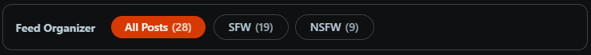

# Reddit Feed Organizer

<p align="center">
  
</p>

<p align="center">
  <strong>A calmer, more controlled way to browse Reddit.</strong><br>
  Keep your everyday feed comfortable when you're browsing in public, at work, around family, or simply in an environment where you want to avoid unexpected NSFW posts.
</p>

<p align="center">
  <a href="src/reddit-feed-organizer.user.js"></a>
  
  
  <a href="LICENSE"></a>
</p>

---

## Why use it?

Reddit mixes content from many communities into one feed. Even if you enjoy browsing Reddit, an unexpected NSFW post can be awkward when you're using your computer in a shared or public space.

**Reddit Feed Organizer** adds a small set of tabs directly above your feed, so you can choose what appears:

- Browse **SFW posts by default** for a more comfortable everyday experience.
- Switch to **All Posts** whenever you want the unfiltered feed.
- Open the **NSFW** tab when you intentionally want to view posts Reddit identifies as NSFW.

It is designed for people who want a simple, quick way to keep their Reddit browsing more suitable for the environment they're in — whether that's an office, a shared room, a public place, or home.

> **A practical note:** This is a client-side convenience filter, not a guarantee of workplace-safe content. It can only identify posts that Reddit exposes as NSFW (plus a basic flair fallback). Unflagged content may still be unsuitable for a particular setting.

## The interface

The organizer sits above the Reddit feed and shows live counts for posts it has detected.

| Tab | What it shows |
| --- | --- |
| **All Posts** | Every detected post, including NSFW-flagged posts |
| **SFW** | Posts not detected as NSFW — selected automatically when the page loads |
| **NSFW** | Posts detected as NSFW |

## Features

- **SFW by default** — the safer browsing view is selected automatically.
- **Three simple tabs** — All Posts, SFW and NSFW. No custom tab setup required.
- **Post counters** — see how many detected posts belong to each category.
- **Dynamic feed support** — newly loaded posts are processed as Reddit adds them.
- **Feed-only operation** — the organizer is disabled on individual post pages and other non-feed pages.
- **Reliable navigation recovery** — returning to the home feed with Reddit's logo, navigating between subreddits, and browser Back/Forward are handled.
- **Lightweight processing** — classifications are cached, and the script processes added/removed post subtrees instead of repeatedly rescanning the entire page.
- **No API credentials** — no Reddit API key, external library, or external service is needed.

## Install

1. Install [Tampermonkey](https://www.tampermonkey.net/) in your browser.
2. Open the [userscript file](src/reddit-feed-organizer.user.js) in this repository.
3. Click **Raw** and install it through Tampermonkey, or copy the source into a new Tampermonkey script.
4. Save the script and refresh Reddit.

**Supported Reddit addresses:**
- `www.reddit.com`
- `old.reddit.com`
- `new.reddit.com`

## Configuration

The settings are at the top of the userscript:

```javascript
const CONFIG = {
    defaultTab: 'sfw',
    showCounts: true,
    sticky: true
};
```

| Option | Description |
| --- | --- |
| `defaultTab` | Initial tab: `all`, `sfw` or `nsfw` |
| `showCounts` | Show detected-post counts on the tabs |
| `sticky` | Keep the tab bar sticky while scrolling |

## Performance approach

The script runs only on supported feed-listing routes. Individual post pages (URLs containing `/comments/`) are explicitly excluded. Reddit's client-side navigation is monitored through URL changes, internal-link clicks, History API events, and browser navigation events. The organizer is stopped and its filtering styles are cleaned up when navigating into a post, then re-enabled when a feed container has actually rendered. Feed-to-feed navigation also resets stale post references and counters before initializing the new feed. On feed pages, a `MutationObserver` notices when Reddit adds or removes feed content. It then:

1. Inspects only the newly added or removed subtree.
2. Caches each post's NSFW classification in a `WeakMap`.
3. Updates counters incrementally.
4. Changes post visibility only when a new post appears or the selected tab changes.

This avoids the previous approach of rescanning every post after unrelated page mutations.

## Known limitations

- The script filters posts that Reddit has already loaded; it does not fetch additional posts.
- NSFW detection relies on Reddit's post attributes, with flair detection as a fallback.
- Reddit can change its page structure at any time, which may require selector updates.
- This script does not change Reddit account settings or server-side content preferences.
- Content that is not correctly flagged by Reddit may remain visible in the SFW tab.

## Contributing and feedback

Bug reports, compatibility notes and improvement suggestions are welcome. If Reddit changes its interface and the tabs stop working, please open an issue with the Reddit page type (Home feed or subreddit) and browser details.

## License

Released under the [MIT License](LICENSE).
